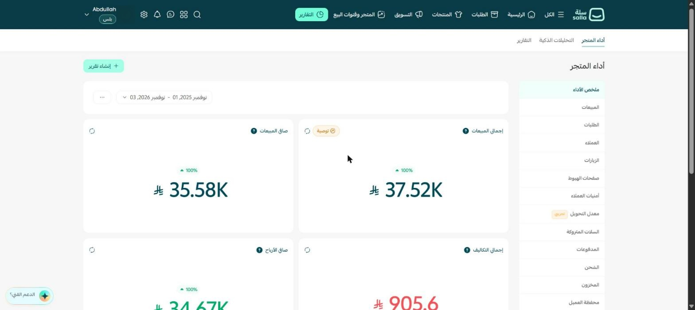
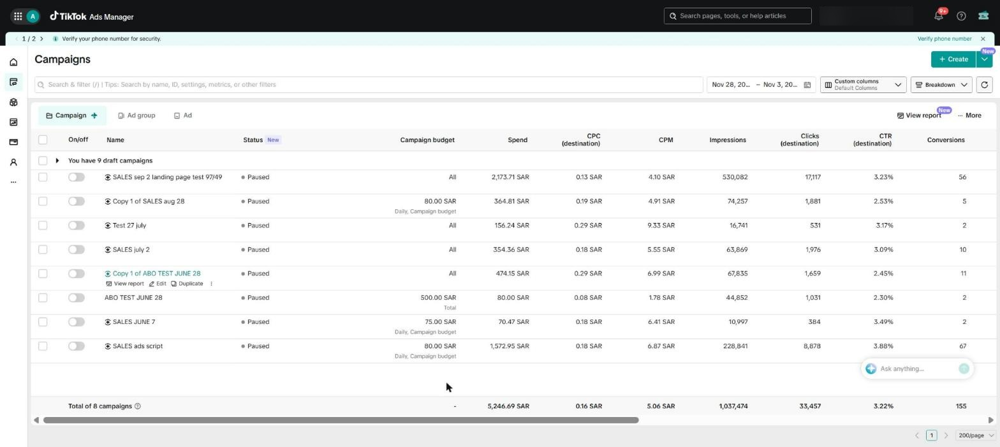
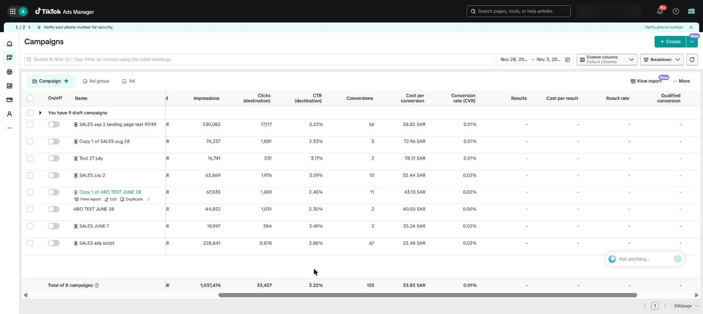

# Marketing Portfolio — Abdullah Albariqi

Performance marketer and copywriter. I run paid campaigns on TikTok, Meta and Snapchat and write the ad scripts and content behind them.

Contact: ipabdullah2@gmail.com

---

## Results: Digital Products E-commerce Brand

The brand name and logo are blurred for client confidentiality. All numbers are real, taken directly from Salla and TikTok Ads Manager.

### Store sales (Salla), Nov 2025 – Nov 2026

- **SAR 37.5K** total sales, **SAR 35.6K** net sales
- Bootstrapped, grown through paid TikTok ads and organic content

### TikTok Ads, lifetime

- **SAR 5.2K** spend, **1M+ impressions**, **3.22% CTR** across 8 campaigns

### The script-led campaign

- The campaign built on my ad script (**"SALES ads script"**) had the highest CTR in the account (**3.88%**)
- Cost per purchase: **SAR 23.48** vs. the **SAR 33.85** account average, about **31% lower**

---

## What I write

- Ad scripts and hooks for TikTok, Snapchat and Instagram Reels
- Product descriptions, landing-page and store copy
- Social captions, carousels and monthly content scripts
- Rewrites for rejected or underperforming ads
